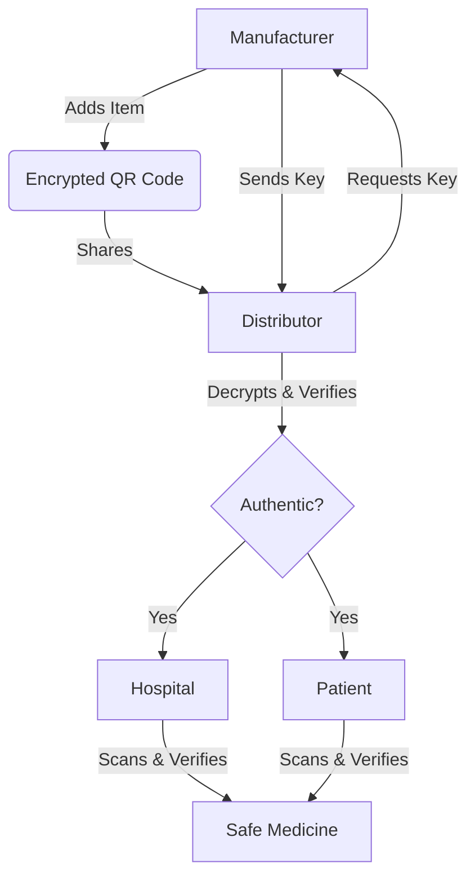

# System Workflow Overview

### 1. Production
Manufacturer creates the medicine entry and the system generates a unique hash and QR code.

### 2. Transfer
The medicine is shared with the next party (Distributor).

### 3. Verification
The receiving party must request a Secret Key to "unlock" the data in the QR code.

### 4. Consumption
The Hospital or Patient performs the final scan to ensure they are receiving what the Manufacturer actually produced.
